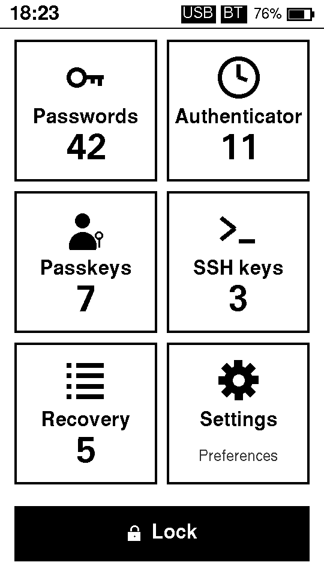
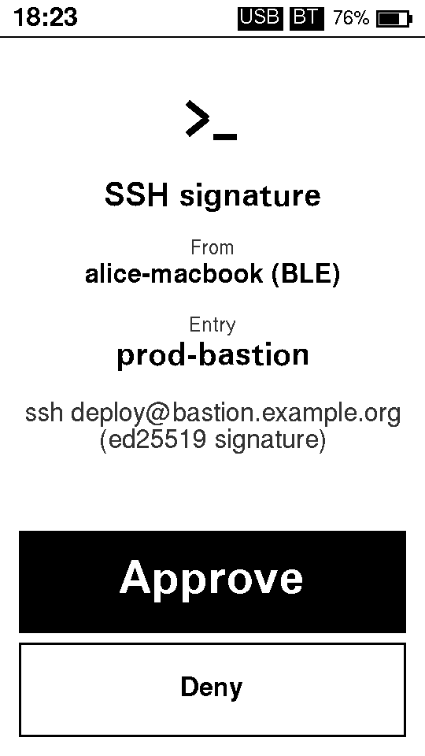
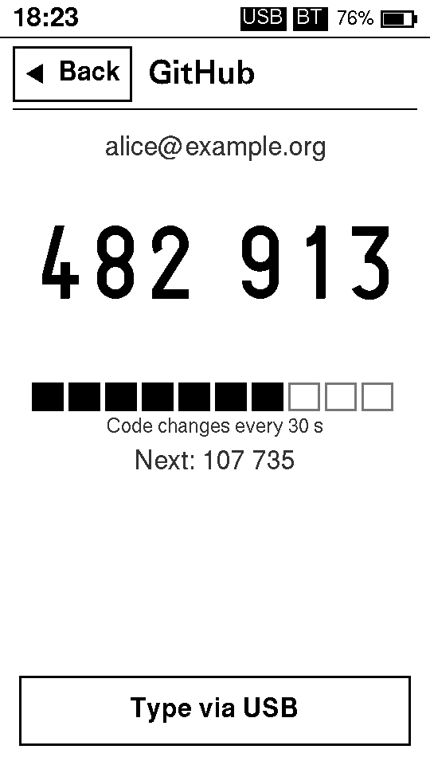
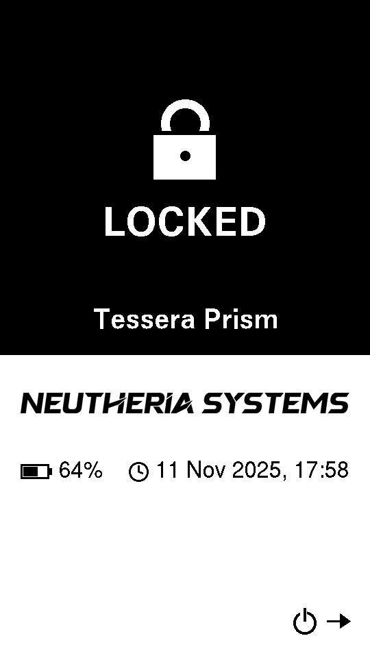
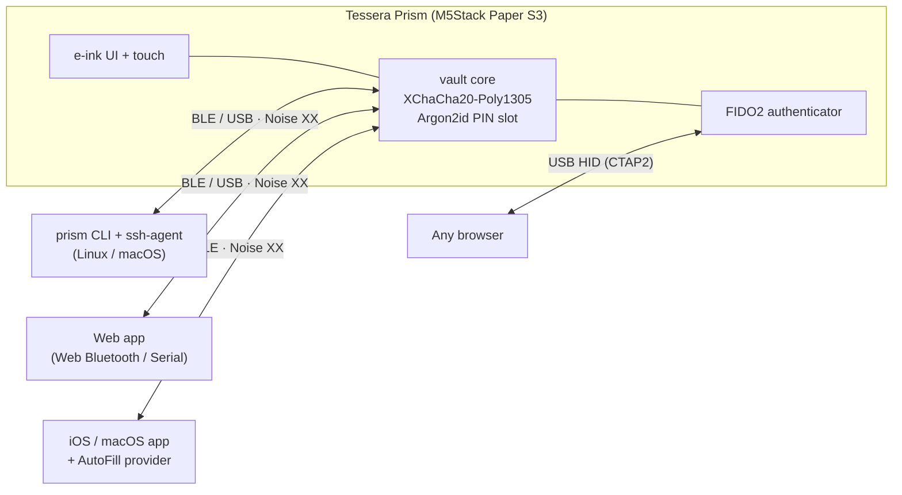

<p align="center">
  
</p>

<h1 align="center">Tessera Prism</h1>

<p align="center">
  <b>An offline-first hardware password manager on an e-ink device.</b><br>
  Passwords · TOTP · Passkeys (FIDO2) · SSH keys · Recovery codes
</p>

<p align="center">
  <a href="https://github.com/jess-sys/TesseraPrism/actions/workflows/ci.yml"></a>
  <a href="#license"></a>
  
  
</p>

---

Tessera Prism turns an [M5Stack Paper S3](https://docs.m5stack.com/en/core/PaperS3) (ESP32-S3,
4.7" e-ink touchscreen, battery) into a pocket vault. Secrets never leave the device in the clear
except when you approve it on its screen. It talks to your computers and phone over
**Bluetooth LE** and **USB**, signs **SSH** logins, acts as a **FIDO2 security key / passkey**
provider, and shows **TOTP** codes. When you're done, *Lock* wipes the keys from RAM and cuts the
power. The e-ink lock screen stays visible with zero power draw.

<p align="center">
  
  
  
  
</p>

## Features

| | |
|---|---|
| **Passwords** | Stored encrypted; reveal on the device, type them via USB keyboard emulation (US / FR-AZERTY), or fetch from a paired companion after a tap. |
| **TOTP** | RFC 6238 codes on the e-ink screen with a countdown, or sent to a companion. Import via `otpauth://` URI or QR. |
| **Passkeys / FIDO2** | CTAP 2.1 authenticator over **USB HID** (any browser), **BLE** (Android), and the **iOS / macOS AutoFill** credential provider. |
| **SSH** | Ed25519 keys generated on the device (seed-derived) or imported. `prism agent` is an `ssh-agent` for Linux/macOS that asks the device for every signature and shows **which host** is asking. |
| **Recovery codes** | Store and tick off one-time recovery codes. |
| **Approval on device** | Every secret use is confirmed on the screen (per-entry policy: always / once per unlock / never), with sounds for requests, approvals and denials. |
| **Backups** | 24-word BIP39 seed shown once at setup, plus encrypted `.prism` exports protected by a recovery passphrase. |
| **Power** | Auto-lock after inactivity; *Lock* = keys zeroized + full power-off. Wakes only with the hardware power button. |

## How it works



- **Encrypted vault.** A random 32-byte master seed (the 24 BIP39 words) is wrapped in two key
  slots: a **PIN** slot (Argon2id, entered on the touchscreen) and an optional **recovery
  passphrase** slot. The vault itself is XChaCha20-Poly1305-encrypted with a seed-derived key and
  lives decrypted only in RAM while unlocked. Ten wrong PINs wipe it.
- **Paired, encrypted transport.** Companions speak a small protocol over a
  `Noise_XX_25519_ChaChaPoly_BLAKE2s` session. A new host is paired by comparing a 6-digit code on
  the e-ink screen. Each host process gets its own BLE *channel*, so the app, its AutoFill
  extension and the CLI can share one Bluetooth link.
- **Derived keys.** SSH and passkey private keys are derived from the seed (HKDF), so a lost
  device can be rebuilt from the 24 words plus an export of the metadata.

Details: [docs/ARCHITECTURE.md](docs/ARCHITECTURE.md) (the protocol contract) and
[docs/SECURITY.md](docs/SECURITY.md) (threat model and production hardening).

## Repository layout

| Path | What |
|---|---|
| [`firmware/`](firmware/) | ESP32-S3 firmware (Rust, `std` on ESP-IDF): e-ink (epdiy), touch, BLE (NimBLE), USB composite (TinyUSB), power management |
| [`crates/prism-core`](crates/prism-core) | Vault crypto, key slots, BIP39, TOTP, export format |
| [`crates/prism-proto`](crates/prism-proto) | Wire protocol, Noise session, BLE/USB framing |
| [`crates/prism-ctap`](crates/prism-ctap) | FIDO2 / CTAP 2.1 authenticator, CTAPHID, CTAP-BLE |
| [`crates/prism-ui`](crates/prism-ui) | E-ink screens (embedded-graphics), host-testable, PNG snapshots |
| [`crates/prism-client`](crates/prism-client), [`crates/prism-cli`](crates/prism-cli) | Host transports, the `prism` CLI and `prism agent` |
| [`crates/prism-wasm`](crates/prism-wasm), [`crates/prism-ffi`](crates/prism-ffi) | Bridges for the web app (wasm-bindgen) and Swift (UniFFI) |
| [`apps/web`](apps/web) | Web companion (Vite + TypeScript) |
| [`apps/apple`](apps/apple) | SwiftUI iOS / macOS app + AutoFill credential provider |

## Getting started

### Pre-built downloads

Every push to `main` refreshes the [nightly pre-release](https://github.com/jess-sys/TesseraPrism/releases/tag/nightly);
version tags (`v*`) publish regular [releases](https://github.com/jess-sys/TesseraPrism/releases). Each one contains:

| File | What |
|---|---|
| `prism-firmware-<ver>.bin` | Merged flash image (bootloader + partitions + app) for the Paper S3 |
| `prism-cli-<ver>-<target>.tar.gz` | `prism` CLI + SSH agent for Linux x86_64 and macOS Apple Silicon |
| `prism-web-<ver>.zip` | Static web companion (serve over HTTPS for Web Bluetooth) |
| `SHA256SUMS.txt` | Checksums |

Flash the image with the board in download mode (hold BOOT while powering on):
`espflash write-bin 0x0 prism-firmware-<ver>.bin`.

### Hardware

An **M5Stack Paper S3** (ESP32-S3R8, 8 MB PSRAM, 16 MB flash, 960×540 e-ink, GT911 touch,
BM8563 RTC, 1800 mAh battery). No other parts needed.

### 1. Build and flash the firmware

Install the Xtensa Rust toolchain and flashing tools:

```sh
cargo install espup espflash ldproxy
espup install            # then: source ~/export-esp.sh
```

Build (the first build downloads ESP-IDF and takes a while):

```sh
cd firmware
cargo build --release
```

Flash. The firmware owns the USB port, so put the board in download mode first: **hold BOOT
while plugging in USB / powering on**. Then power-cycle normally after flashing.

```sh
BL=$(find target/xtensa-esp32s3-espidf/release/build -path '*out/build/bootloader/bootloader.bin' | head -1)
espflash flash --chip esp32s3 --flash-size 16mb --partition-table partitions.csv \
  --bootloader "$BL" target/xtensa-esp32s3-espidf/release/prism-firmware
```

On first boot the device walks you through choosing a PIN and writing down the **24-word
recovery seed**. Store the seed offline. It is the only way to recover your keys.

See [firmware/README.md](firmware/README.md) for the diagnostic `jtag-console` build (logs over USB).

### 2. CLI and SSH agent (Linux / macOS)

```sh
git clone https://github.com/jess-sys/TesseraPrism.git && cd TesseraPrism
cargo install --path crates/prism-cli      # installs `prism`
prism pair                                 # device: Settings → Pair new host, compare the code
prism info
prism add totp 'otpauth://totp/Example:alice?secret=JBSWY3DPEHPK3PXP&issuer=Example'
prism totp "Example: alice"                # approve on the device
```

SSH:

```sh
prism ssh-gen laptop                       # Ed25519 key generated on the device
prism ssh-pubkey laptop                    # add this to ~/.ssh/authorized_keys or GitHub
prism agent install                        # launchd / systemd --user service
export SSH_AUTH_SOCK=~/.prism/agent.sock
ssh -T git@github.com                      # the device shows "github.com" and asks for a tap
```

Other commands: `ls`, `show`, `add password|recovery|ssh-import`, `rm`, `export`, `import`,
`recovery-passphrase set`, `settings`, `hosts`. See `prism --help`.

### 3. Passkeys

- **USB (any OS, any browser):** plug the device in and pick *"Security key"* when a site offers a
  passkey. Approve on the device.
- **iPhone / Mac over Bluetooth:** install the Apple app (below), then enable it under
  *Settings → General → AutoFill & Passwords* and choose **Prism** when saving or using a passkey.
- **Android:** the device advertises the standard FIDO BLE service.

### 4. Web companion

Chrome / Edge (Web Bluetooth and Web Serial):

```sh
wasm-pack build crates/prism-wasm --target web --out-dir ../../apps/web/src/wasm/pkg
cd apps/web && npm install && npm run dev
```

### 5. iOS / macOS app

Requires Xcode 16+, [XcodeGen](https://github.com/yonaskolb/XcodeGen) and an Apple developer
team (the AutoFill entitlement needs one).

```sh
crates/prism-ffi/build-xcframework.sh
cd apps/apple
cp Local.xcconfig.example Local.xcconfig   # set PRISM_TEAM_ID to your team
./generate.sh && open Prism.xcodeproj
```

See [apps/apple/README.md](apps/apple/README.md) for details, including changing the bundle-ID prefix.

## Development

```sh
cargo test --workspace                     # host crates (≈100 tests, incl. a fake device)
cargo test -p prism-ui                     # also regenerates the screen snapshots in crates/prism-ui/snapshots
(cd apps/web && npm test)
(cd apps/apple/PrismKit && swift test)
```

The UI is fully host-testable: every screen is rendered to PNG by the `prism-ui` tests, which is
also where the screenshots above come from.

## Status

Tessera Prism is **pre-1.0 and has not been security-audited**. It runs on real hardware with:
setup and PIN unlock, BLE/USB pairing, TOTP, SSH signing through `prism agent`, passkeys over USB
and through the iOS/macOS AutoFill provider, auto-lock and power-off.

Known gaps and next steps:

- **Hardware-bound PIN is on** (eFuse HMAC key, generated on the device). **Flash encryption and secure boot are not enabled yet** ([roadmap](docs/plans/hardware-security.md)): development builds have no flash
  encryption or secure boot; see the (irreversible) procedure in [docs/SECURITY.md](docs/SECURITY.md).
- FIDO2 credential management (listing / deleting passkeys from the OS) is not implemented yet.
- No microSD backup and no on-device entry editing yet.

## Contributing & security

Contributions are welcome. Start with [CONTRIBUTING.md](CONTRIBUTING.md). Please report
vulnerabilities privately as described in [SECURITY.md](SECURITY.md).

## License

Licensed under either of [Apache License, Version 2.0](LICENSE-APACHE) or [MIT license](LICENSE-MIT)
at your option. Unless you explicitly state otherwise, any contribution intentionally submitted for
inclusion in this project shall be dual-licensed as above, without any additional terms or conditions.

"Neutheria Systems" and the Neutheria Systems logo are not covered by these licenses.
